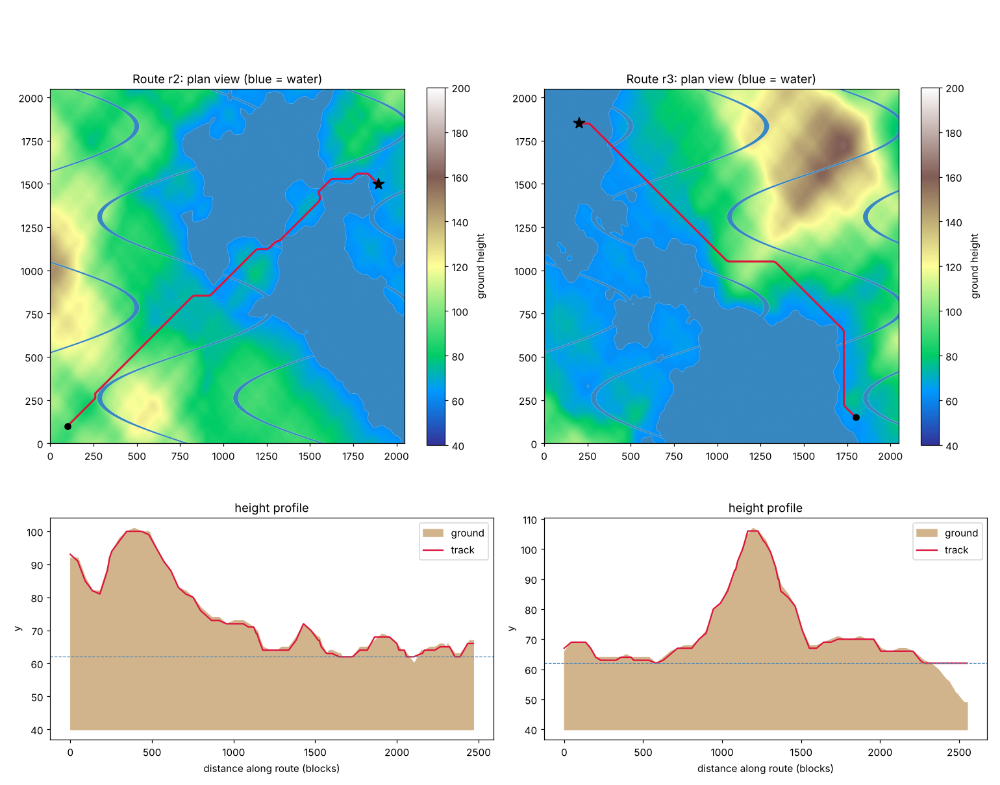

# Track Planner: research notes

Goal: Factorio-style rail planning for Create trains. You pick a start track and any end point, the game finds a buildable route between them, and the route appears as a blueprint for players to build.

Status: research only, nothing in the pack changes. A working pathfinder prototype is in `prototype/`.

Pack versions checked: Create 6.0.10, Steam 'n' Rails 0.3.0-beta.2, Loconautics 0.1.2BETA, Sable 2.0.6, NeoForge 21.1.265, Minecraft 1.21.1.

## Short answer

It is feasible as a custom mod, built in `mods-src/` like Desire Paths.

- **Create's track rules fit a pathfinder well.** Every legal track piece is one of a small set of moves (see below).
- **The search is fast enough.** The prototype finds a 2.5 km route over hills, lakes and a river in about 0.25 s.
- **Create already supports a "blueprint" route.** The schematicannon can print curved track and charges the correct number of track items for each curve.

Most of the work is in-game plumbing: reading terrain without freezing the server, showing ghost track, building in survival, and respecting land claims. The search itself is the easy part.

## How Create track placement works (`TrackPlacement.tryConnect`)

These rules come from the Create 6.0.10 source. A planner has to produce only moves that satisfy them, or the track it builds won't be valid.

| Rule | Value |
|---|---|
| Headings | 8 (N/E/S/W and the four diagonals) |
| Max length of one placement | `maxTrackPlacementLength` = 128 blocks (server config) |
| 90° turn | turn size ≥ 7, plus 2 for each block of climb above 3 |
| 45° turn | turn size ≥ 3.25, plus 1.5 for each block of climb above 1.5 |
| Turns sharper than 90° | not allowed (`turn_90`) |
| Straight climb | horizontal run ≥ max(4×rise if rise < 4 else 3×rise, 6) |
| S-bend | parallel ends; length ≥ 2× sideways offset; must be level |
| Turning on a slope block | not allowed (climb inside the curve instead) |

Every non-straight piece is a `BezierConnection` stored in the `TrackBlockEntity` at both ends. Straight runs are ordinary track blocks. `placeTracks` is private, so the mod would either reimplement its roughly 40 lines or call it through an access transformer.

Paving under the track (offhand block) is in `TrackPaver.paveStraight` and `TrackPaver.paveCurve`. These can be reused for embankments and bridge decks.

For schematics, `TrackBlock.getRequiredItems` adds up `BezierConnection.getTrackItemCost()` and the girder cost. A schematic that contains curves therefore charges the right materials when printed. Schematic size is capped by `maxTotalSchematicSize` (256 KB by default), so a long line has to be split into tiles.

## Steam 'n' Rails and Loconautics

- **Steam 'n' Rails** adds track materials (woods, monorail, narrow and wide gauge). The planner should take the material from the item in hand, as Create's `TrackMaterial.fromItem` does. Monorail and non-standard gauges should be tested separately before they are allowed.
- **Loconautics** trains still run on Create track; `[track] railSearchRadius` and `[track.derailment]` in `loconautics-server.toml` act on Create rails. Two of its settings matter for routing:
  - `slopeEffects = true`: grades slow heavy trains. The planner charges for climbing (`W_CLIMB`) and should keep a soft maximum grade.
  - `derailOnCurve = false`: tight curves are safe now. If that setting changes, prefer wide curves.

  The Loconautics jar could not be downloaded here (CurseForge is blocked from this environment), so its code was not inspected.

## Existing mods: check before building

Neither CurseForge nor Modrinth could be opened from this environment, so this list comes from search results only and is unverified:

- **[Create: Auto Track](https://www.curseforge.com/minecraft/mc-mods/create-auto-track)**: a "Builder Block" machine. You set a destination in its GUI and it lays railway with chosen track and roadbed. This is the closest match. **Check its loader, version and how it routes before building our own.**
- **[Automatic Railway Generation](https://modrinth.com/project/qUULEIKC)**: builds Create railways automatically between spawn and villages as you explore (Create 6.0.10+). It generates rails by itself and is not player-planned. In development, and it edits terrain.
- **[Railway tools for Axiom](https://modrinth.com/mod/railway-tools-for-axioms)**: route tools for the Axiom editor, aimed at large builders. Not a survival tool.
- **Railways Untold / Create: Infinite Railways**: procedurally generated railways. Different goal.
- **[Create Railways Navigator](https://modrinth.com/mod/create-railways-navigator)**: finds journeys over existing track. It does not build anything.

## Pathfinding approach (prototype)

`prototype/TrackPlannerProto.java` is one standalone Java file. Run it with `java -Xmx4g TrackPlannerProto.java <size> <seed> <sx> <sz> <gx> <gz> <out>`. It runs on generated terrain, not Minecraft, in three stages:

1. **Corridor.** Dijkstra over 16×16 cells (about chunk size), run from the goal. It gives an approximate cost-to-goal for every cell and a band about 4 chunks wide around the best rough route.
2. **Route on the map.** A* over (x, z, heading), using only Create-legal moves: straights of 4/8/16/32 steps, 45° turns, and 90° turns. Cost is track length + curve penalty + ground climbed or dropped + water crossed. The stage-1 cost-to-goal guides the search.
3. **Height profile.** Dynamic programming over the height of each anchor point along that route. Each segment's climb is limited by Create's grade and curve rules. Cost covers fill/embankment, bridges, cuts and tunnels.

Searching x, z, height and heading together ran out of memory. Splitting the route from the height profile is how real railway alignment is designed, and it is fast.

| Run | Straight-line | Route length | A* nodes | Time |
|---|---|---|---|---|
| r1 (1024² map) | 1238 | 1278 | 91 | ~0.13 s |
| r2 (2048² map) | 2280 | 2476 | 219 | ~0.18 s |
| r3 (2048² map) | 2335 | 2552 | 133 | ~0.23 s |

Without the stage-1 guide, r2 and r3 took about 150 s each and expanded about 33 million nodes. With it, the routes came out within 1% of the same length.

Known gaps in the prototype:

- Cost weights are untuned. r3 climbs a 40-block hill where a short tunnel would be better, so tunnels are priced too high.
- Bridges over water sit at sea level. They need clearance above the water.
- The route ends anywhere within 4 blocks of the goal. A real mod must finish with an exact join, using the same S-bend or curve logic as `tryConnect`, at a heading the player chooses.
- Curves are costed with a quadratic approximation of Create's cubic Bezier.

## Proposed mod design

**Planner item.** Right-click an existing track end (or any block for a new line), walk or fly to the target, and right-click again. The target could also be picked on Xaero's world map later. The search runs on a worker thread, never the server tick. The result is a "plan" saved as world `SavedData`: a list of segments (start, heading, `BezierConnection` data, height, material) plus volumes to dig out and supports to place.

**Reading terrain.**

- Chunks already generated: read the saved chunks' heightmaps in the background. A 2.5 km corridor is about 1,500 chunks.
- Chunks never generated: estimate the ground with `ChunkGenerator.getBaseHeight`. It's cheap but ignores trees and structures, so re-check the route once those chunks generate.
- Claimed land (MineColonies colonies, other nations' claims) costs infinity, so routes never cross it.

**Ghost display.** The client renders the plan as translucent track using Create's own track renderer, like the existing track placement overlay. Paged in by distance, so a 3 km plan doesn't render all at once.

**Building it.** Several options, which can ship in phases:

1. **Creative/op:** instant build. Useful for testing and server-built mainlines.
2. **Survival, by hand:** segments within reach are built automatically when you hold the plan item and carry the materials (tracks, plus paving or girders for bridges). This uses the same inventory code as Create's own placement, like Factorio's personal roboport.
3. **Schematic export:** write the plan as a series of Create schematic tiles for the schematicannon. This uses only Create's existing machinery, but long lines need the cannon moved from tile to tile.
4. **Track-laying train car** (the most Factorio-like, similar to the FARL mod): a contraption block that, as the train moves onto fresh track, places the next planned segments from the train's inventory. The most fun and the most work.

Recommended order: 1 → 2 → 4, with 3 as an optional extra.

## Risks

- **Internal code.** Create's track code isn't a public API. The mod must be pinned to Create 6.0.x and retested on every Create update. Loconautics and Steam 'n' Rails are both beta.
- **Unloaded chunks.** Building far from players needs the chunks loaded (forced chunk tickets, like trains use), or building only near a player.
- **Earthworks in survival.** Who digs tunnels and pays for the blocks? Options: dig for free, charge only for track, or require a Create drill contraption. This is a balance decision for the pack.
- **Multiplayer protection.** Placement must fire NeoForge block-place events so claim and protection mods can block it.

## Next steps

1. Check Create: Auto Track (and ARG) in a test instance. If one already does this well enough, use it instead.
2. If not, scaffold `mods-src/track-planner` from Desire Paths (moddev 2.0.148, Create 6.0.10 as a compile dependency).
3. First milestone: creative-only planner item + server search + ghost display + instant build, with a game test that builds a plan and checks that Create's track graph connects start to end.
