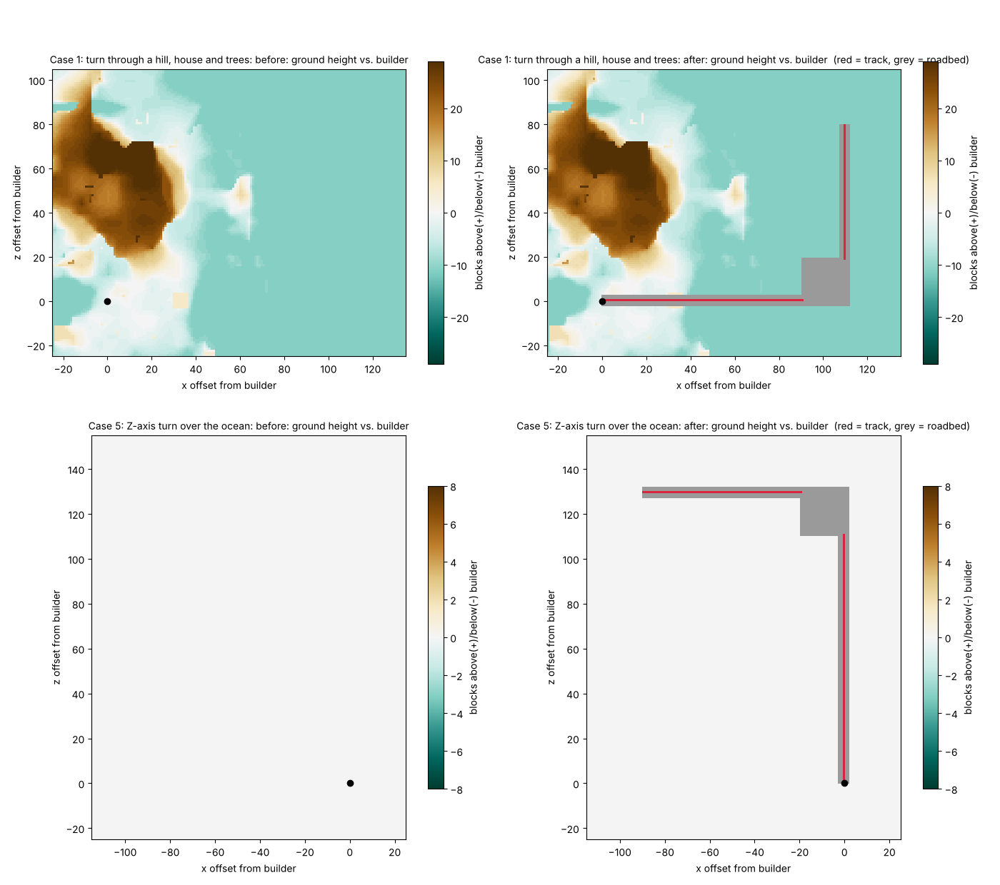

# Create: Auto Track: test results

A test of [Create Auto Track](https://modrinth.com/mod/create-auto-track) 2.0.2 (NeoForge 1.21.1, WTFPL, [source](https://github.com/117458866249/CrAuTrack)) on a headless NeoForge 21.1.265 server with Create 6.0.10. The Create jar is byte-identical to the pack's. The released jar was checked against the 1.21.1 source branch.

`Attest.java` is a throwaway harness mod. It runs when the server starts and, for each case:

1. places the Track Builder with a roadbed block and a track on top, as the tooltip says;
2. uses the Position Selector the way a sneaking player would (it posts the same right-click events);
3. records the blocks before and after the build;
4. after ~20 s of game time, asks Create's railway manager whether start and end are on one connected track network a train could route over.

The test areas are force-loaded, as they would be with a player nearby. Without that, Create never registers the new track.

## How it works (source + test)

- **It is not a pathfinder.** It always builds an L: a straight run along the axis the builder faces, one fixed 90° curve (19-block radius, written as hard-coded track NBT), then a straight run to the target. There are no diagonals, no slopes and no route choice.
- **Always flat at the builder's height.** The target's height is ignored. Case 1's line ends 11 blocks in the air over the ocean, and case 6's target was 53 blocks up a hill.
- **It bulldozes a strip 5 wide and 6 tall.** Everything above the roadbed is set to air, with no drops, and a 5-wide roadbed is laid under the track. In case 1 that removed the test house (73 blocks), trees (48) and a hillside (22 blocks dug, 74 replaced). The chest's diamonds spilled onto the ground. Over water it lays a floating 5-wide wool causeway, and the curve's corner becomes a solid 20×20 pad.
- **It's free.** No track, roadbed or other materials are taken from the player; inventory was unchanged in every case. The Builder Block itself is consumed (it becomes roadbed).
- **No protection checks.** It places blocks directly with `setBlock` and fires no block-place events, so claim or colony protection mods can't stop it.
- **Long lines freeze the server.** It builds all at once on the server thread, loading chunks as it goes. Case 6 (1.8 km) froze the server for **14.3 s** in one tick. Vanilla's watchdog kills the server after a 60 s tick, so a line of roughly 7 km or more could crash it.
- **What works:** every line it built was one connected Create track network that a train can route over. Cases 1, 5 and 6 routed start→end over 183, 213 and 1793 blocks of rail. The tracks are ordinary Create tracks, so they should suit Loconautics trains too (not tested here).
- **Refusals:** "Invalid route!" if the target is within 20 blocks on both axes, or less than 20 blocks along the builder's axis (cases 3 and 4).

| Case | Setup | Result |
|---|---|---|
| 1 | X-axis, target +110/+80 through hill, house, trees | L built, 154 track blocks, connected, house and trees erased |
| 2 | X-axis, target +180/+4 (straight) | straight built over ocean, 905 roadbed blocks |
| 3 | target +12/+14 | "Invalid route!" |
| 4 | X-axis, target +5/+120 | "Invalid route!" (axis must be switched by hand) |
| 5 | Z-axis, target -90/+130 | L built, connected |
| 6 | target -1000/-800, unloaded terrain | built, connected, 14.3 s server freeze |

## Verdict for this pack

Not suitable as-is for a multiplayer nations server. It's an admin-style terraforming shortcut: free, unprotected, flat, and L-shaped only. It isn't a Factorio-style planner. Two pieces are useful for our own mod: writing curve track NBT straight into `TrackBlockEntity` does produce working rails, and the test harness here can check our planner's output the same way.

## Re-running

Copy `gradle/`, `gradlew` and `settings.gradle` from `../../desire-paths`, and set the project name to `attest`. Put the Create 6.0.10 jar into `libs/` and `run/mods/`. Extract the jars inside its `META-INF/jarjar/` into `libs/jij/`. Put `create_auto_track-2.0.2.jar` into `run/mods/`. Write `eula=true` to `run/eula.txt` and set `online-mode=false` in `run/server.properties`. Then run `./gradlew runServer`; the report lands in `run/attest-out/`. Draw the maps with `python3 plot_at.py out.png "run/attest-out/s1_turn.csv=Case 1"`.
